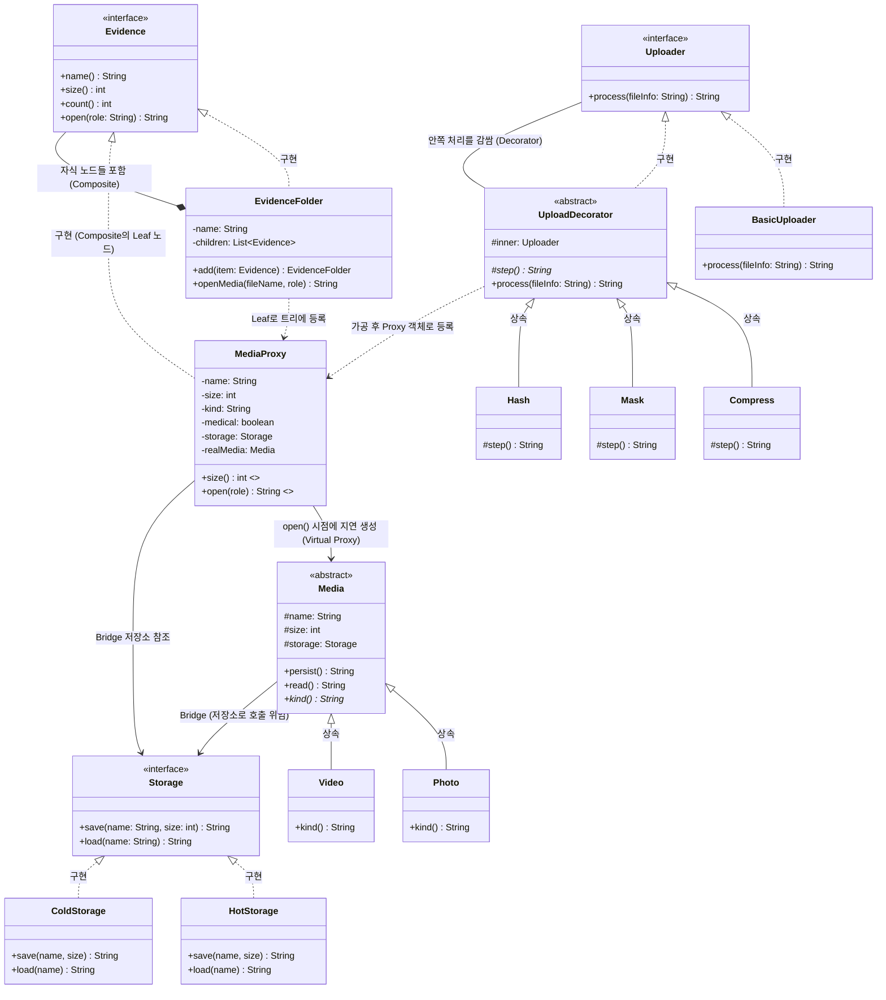
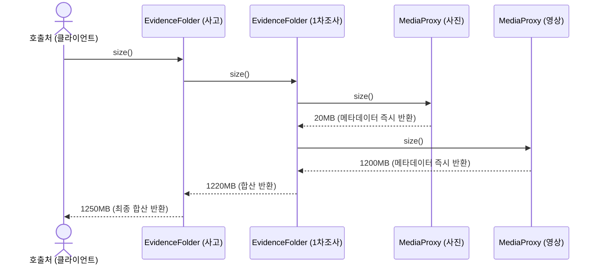
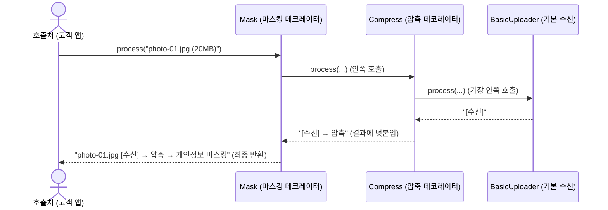
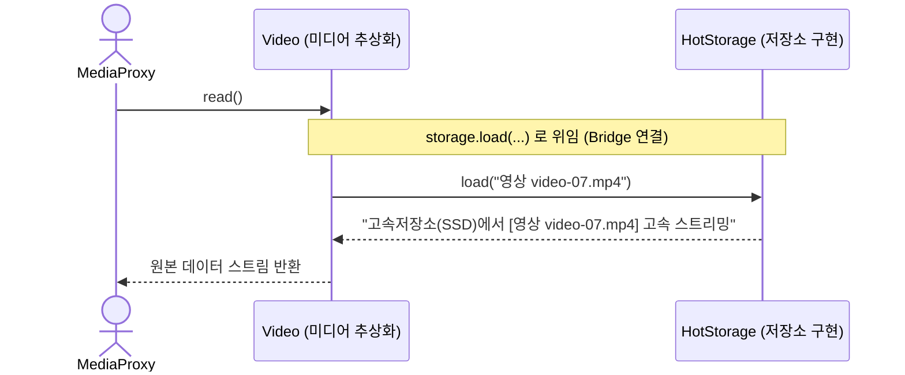
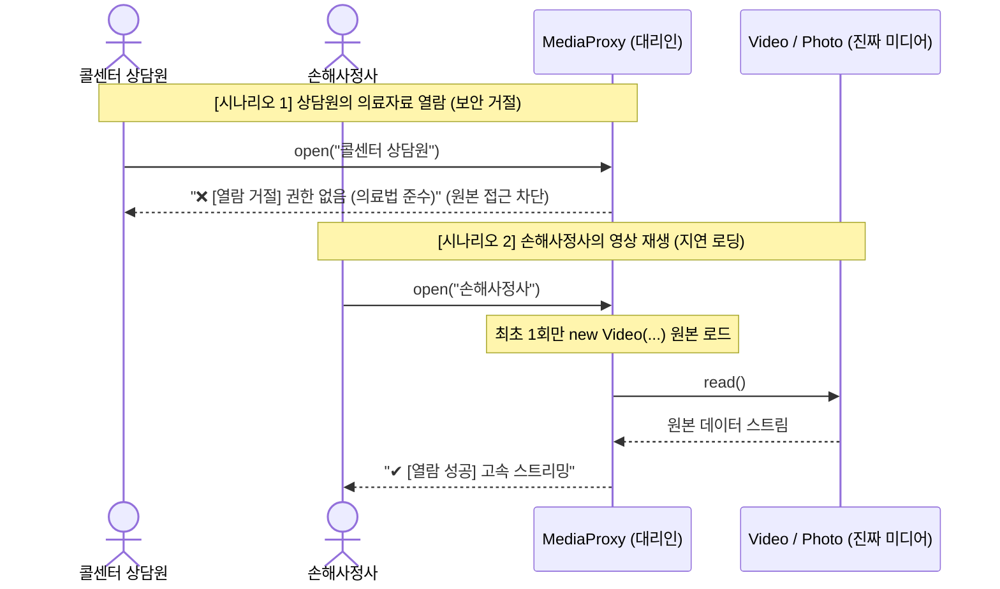

# 3조 발표 – 손해사정 사진·영상 처리·저장 통합 시스템

> 발표 시간: 약 5분 · 코드: [src/](file:///c:/Users/SDS/Desktop/usecase/team3-media/src) · 실행: `.\run.ps1`

---

## 🏛️ 전체 시스템 아키텍처 클래스 다이어그램 (Class Diagram)

4개 디자인 패턴(Composite, Proxy, Bridge, Decorator)이 단일 손해사정 시스템으로 유기적으로 결합된 전체 구조도입니다.



---

## 💡 4대 패턴 통합 연결고리 (How They Work Together)

| 디자인 패턴 | 시스템 내 역할 | 타 패턴과의 결합점 |
| :--- | :--- | :--- |
| **Decorator** | **미디어 수집 & 전처리** | 고객 앱 / 현장 조사에서 인입된 파일을 압축·마스킹·해시 파이프라인으로 가공 후, 생성된 미디어를 트리에 등록 |
| **Bridge** | **저장 계층 독립성** | 미디어 종류(`Photo`, `Video`)와 물리적 저장소(`HotStorage`, `ColdStorage`)를 분리하여 `storage.save()` 위임 호출 |
| **Proxy** | **Composite의 Leaf & 관문** | `Evidence`를 구현하여 Composite 트리의 Leaf로 들어가며, 실제 Bridge 미디어 객체의 **지연 로딩(Virtual)** 및 **의료 권한 통제(Protection)** 수행 |
| **Composite** | **전체 증빙 계층 구조** | `사고 → 조사 회차 → MediaProxy`를 단일 `Evidence` 인터페이스로 통합하여 단 한 번의 `.size()` 호출로 트리 전체 용량 집계 |

---

## 슬라이드 1. 우리가 풀 문제

**🚗 도메인 배경: 우리는 지금 무슨 일을 하는 시스템인가요?**
* **자동차 사고 발생**: 고객이 앱으로 파손 부위 사진을 올리고, 손해사정사가 현장 출동해 영상·진단서(의료 사진)를 업로드합니다.
* **3조의 역할**: 쏟아지는 **대용량 미디어를 수집·가공·저장하고, 필요한 사용자에게 안전하게 제공**하는 단일 미디어 계층을 설계합니다.

| # | 발생 문제 | 핵심 요구사항 | 적용 패턴 |
| :-: | :--- | :--- | :--- |
| 1 | 계층적 증빙 폴더 구조 | 어느 단계에서든 일관된 용량·건수 조회 | **Composite** |
| 2 | 출처마다 다른 가공 절차 | 처리 단계의 유연한 조립과 확장 | **Decorator** |
| 3 | 미디어 종류와 저장소의 조합 폭발 | 두 축을 분리하여 독립적 확장 보장 | **Bridge** |
| 4 | 대용량 로딩 지연 및 민감정보 보호 | 필요 시점에만 로드, 역할 기반 접근 통제 | **Proxy** |

---

## 슬라이드 2. Composite – 계층 구조 단일화

| 구분 | 내용 |
| :--- | :--- |
| **1) 도메인 상황** | • 사고 증빙 자료는 복잡한 계층 구조(트리 구조)로 되어 있습니다.<br>• `사고(AC-2081)` 폴더 밑에 ➔ `1차 조사(현장)` 폴더가 있고 ➔ 그 안에 `MediaProxy(Leaf)`들이 들어있습니다.<br>• 나중에 다중 추돌 사고가 나면 `연쇄사고(사고군)`라는 더 큰 폴더로 묶을 수도 있습니다. |
| **2) 개발자의 고민** | • "파일 용량 구할 땐 `file.getSize()` 부르고, 폴더 용량 구할 땐 `folder.calculateTotalSize()` 부르고, 연쇄사고는 또 다른 함수 만들어야 하나?"<br>• "단계가 늘어날 때마다 화면에서 용량 표시하는 코드를 매번 고쳐야 하나?" |
| **3) 패턴 해결책** | **"파일이든 폴더든 겉보기엔 똑같은 놈(`Evidence`)으로 취급하자!"**<br>• **인터페이스 약속 (`Evidence`)**: 파일이든 폴더든 무조건 `size()`(용량)와 `count()`(개수)를 대답할 수 있게 만듭니다.<br>• **리프 (`MediaProxy`)**: 자기 용량(예: 20MB)을 가볍게 즉시 반환합니다.<br>• **폴더 (`EvidenceFolder`)**: 자기가 품고 있는 자식들에게 "너네 용량 다 가져와봐" 해서 **합산**해서 반환합니다.<br>• **효과**: 밖에서 볼 때는 그게 낱개 파일이든, 1차 조사 폴더든, 사고 전체 폴더든 똑같이 `.size()` 한 번만 호출하면 끝납니다! 나중에 '사고군' 폴더가 새로 생겨도 코드를 한 줄도 수정할 필요가 없습니다. |

**시퀀스 다이어그램 (재귀적 합산 흐름)**



* **데모 확인**: `1차 현장조사: 2건, 1220MB` / `사고(AC-2081): 3건, 1250MB` (동일한 `.size()` 호출)
* **관련 코드**: `composite/Evidence.java`, `composite/EvidenceFolder.java`

---

## 슬라이드 3. Decorator – 처리 단계 조립

| 구분 | 내용 |
| :--- | :--- |
| **1) 도메인 상황** | • 사진/영상이 들어오는 출처마다 거쳐야 하는 작업이 다릅니다.<br>• **고객이 앱으로 올릴 때**: 남의 차 번호판이나 행인 얼굴이 찍혔으니 `[압축]`하고 `[개인정보 마스킹]`을 해야 합니다.<br>• **현장 직원이 올릴 때**: 법적 증거 자료이므로 위조/변조를 막기 위해 `[압축]`하고 `[위변조 방지 해시코드]`를 생성해야 합니다.<br>• **나중에는?**: 일부 사진엔 `[AI 파손 부위 판독]`도 추가로 붙인다고 합니다. |
| **2) 개발자의 고민** | • `고객앱용_업로더`, `현장조사용_업로더`, `AI붙은_고객앱_업로더`...<br>• 필요한 조합마다 클래스를 만들다 보면 수십 개가 생겨서 감당이 안 됩니다 (**클래스 폭발 문제**). |
| **3) 패턴 해결책** | **"서브웨이 샌드위치나 커피 토핑처럼 감싸서 조립하자!"**<br>• 기본 빵(기본 수신: `BasicUploader`)이 있습니다.<br>• 그 위에 치즈를 얹듯 **압축(`Compress`)**으로 감싸고, 그 위에 베이컨을 얹듯 **마스킹(`Mask`)**으로 또 감쌉니다.<br>• 예시 코드: `new Mask(new Compress(new BasicUploader()))`<br>• **효과**: 나중에 `AI판독`이 추가되면? 새 클래스 하나 쓱 만들어서 `new AI(new Compress(...))` 형태로 끼워 넣기만 하면 끝납니다! 기존 코드는 손댈 필요가 없습니다. |

**시퀀스 다이어그램 (체인 호출 흐름)**



* **데모 확인**: `photo-01.jpg [수신] → 압축 → 개인정보 마스킹` / `video-07.mp4 [수신] → 압축 → 위변조방지 해시`
* **관련 코드**: `decorator/` 패키지 (`Uploader`, `BasicUploader`, `UploadDecorator`, `Compress`, `Mask`, `Hash`)

---

## 슬라이드 4. Bridge – 미디어 종류와 저장소 분리

| 구분 | 내용 |
| :--- | :--- |
| **1) 도메인 상황** | • **올리는 미디어 종류**: 사진, 동영상 (나중엔 블랙박스 추가 예정)<br>• **저장할 저장소 위치**: 비싸지만 빠른 고속 스토리지, 싸지만 느린 장기 보관용 스토리지 (나중엔 외부 아카이브 추가 예정) |
| **2) 개발자의 고민** | • 상속으로 만들면 이렇게 됩니다:<br>  - `고속저장소_사진`, `보관저장소_사진`<br>  - `고속저장소_영상`, `보관저장소_영상`<br>• 만약 여기에 블랙박스(미디어)와 외부 아카이브(저장소)가 추가되면? 클래스 개수가 $3 \times 3 = 9$개로 곱하기로 불어납니다. |
| **3) 패턴 해결책** | **"무엇을(미디어)과 어디에(저장소)를 분리하고, 다리(Bridge)로 잇자!"**<br>• **왼쪽 축(미디어)**: `Media` 추상 클래스 밑에 `Photo`, `Video`만 만듭니다.<br>• **오른쪽 축(저장소)**: `Storage` 인터페이스 밑에 `HotStorage`, `ColdStorage`만 만듭니다.<br>• **다리 놓기**: `Media` 클래스 안에 `Storage storage;` 변수를 하나 넣어둡니다.<br>• **효과**: 미디어 3종류, 저장소 3종류가 되어도 클래스는 딱 **6개(3+3)**만 있으면 됩니다. 곱하기($N \times M$)가 아니라 더하기($N + M$) 구조로 깔끔해집니다! |

**시퀀스 다이어그램 (위임 호출 흐름)**



* **관련 코드**: `bridge/` 패키지 (`Media`, `Photo`, `Video`, `Storage`, `HotStorage`, `ColdStorage`)

---

## 슬라이드 5. Proxy – 지연 로딩 및 권한 통제

| 구분 | 내용 |
| :--- | :--- |
| **1) 도메인 상황** | • **성능 이슈**: 파일 목록/용량만 보려고 하는데, 1.2GB짜리 동영상 원본을 매번 디스크에서 읽어오면 서버 메모리가 터지고 속도가 엄청 느려집니다.<br>• **보안 이슈**: 다친 부위 사진이나 진단서 같은 **민감한 의료정보**는 콜센터 상담원이 함부로 열람하면 법적으로 큰일 납니다. 반드시 **손해사정사** 같은 권한 있는 사람만 봐야 합니다. |
| **2) 개발자의 고민** | • "목록 볼 때 무거운 동영상 원본을 매번 안 읽어오게 하려면 코드를 어떻게 짜야 하지?"<br>• "의료 정보 권한 체크 로직을 비즈니스 코드 곳곳에 if문으로 다 도배해야 하나?" |
| **3) 패턴 해결책** | **"진짜 영상 앞에 깐깐한 대리인(`MediaProxy`)을 세우자!"**<br>• `MediaProxy`는 Composite의 `Evidence` 인터페이스를 구현하여 트리에 쏙 들어갑니다.<br>• **보안 검사 (Protection Proxy)**: 콜센터 상담원이 열람을 요청하면? ➔ 대리인이 **"권한 없음! 거절합니다"** 하고 진짜 영상은 생성하지도 않고 쫓아냅니다.<br>• **지연 로딩 (Virtual Proxy)**: 용량 조회할 때는 무거운 영상을 절대 안 불러옵니다. 손해사정사가 진짜로 **"재생/열람"** 버튼을 누르는 순간! 그때 비로소 진짜 `Media` 객체를 생성해서 스트리밍합니다. |

**시퀀스 다이어그램 (보안 거절 & 지연 로딩 흐름)**



* **데모 확인**:
  - `(1) 손해사정사 영상 재생 ➔ [Virtual Proxy] 저장소에서 video-07.mp4 원본(1200MB) 비동기 로드`
  - `(2) 상담원 의료사진 열람 ➔ ❌ [열람 거절] medical-01.jpg 열람 불가 (콜센터 상담원 권한 없음)`
  - `(3) 손해사정사 의료사진 열람 ➔ ✔ [열람 성공] 보관저장소에서 원본 아카이브 로드`
* **관련 코드**: `proxy/MediaProxy.java`

---

## 슬라이드 6. 핵심 요약 (발표 마무리)

| 바뀌는 것 (요구사항 변화) | 보호하려는 것 (불변) | 적용 패턴 | 비즈니스 가치 |
| :--- | :--- | :---: | :--- |
| 증빙 계층 구조의 변화 (사고군 추가) | 일관된 용량·건수 조회 인터페이스 | **Composite** | UI 수정 없이 무제한 계층 확장 |
| 출처별 가공 단계와 순서의 변화 | 기존 처리 파이프라인의 독립성 | **Decorator** | 신규 AI 전처리 무수정 추가 (OCP) |
| 미디어 종류와 저장소 인프라의 확장 | 미디어-스토리지 간의 결합도 최소화 | **Bridge** | $N \times M$ 곱하기 폭발을 $N+M$으로 방지 |
| 로딩 타이밍 최적화 및 접근 권한 통제 | 클라이언트 호출 코드의 단순성 | **Proxy** | 대용량 I/O 비용 0% 및 컴플라이언스 준수 |

> **🎤 5줄 요약 마무리 멘트**
> 1. **계층적 증빙 폴더 구조**는 ➔ **Composite** 패턴으로 조회를 단일화했습니다.
> 2. **출처별 가공 파이프라인**은 ➔ **Decorator** 패턴으로 레고 블록처럼 유연하게 조립했습니다.
> 3. **미디어 종류와 저장소의 조합 문제**는 ➔ **Bridge** 패턴으로 두 축을 분리해 클래스 폭발을 막았습니다.
> 4. **대용량 부하와 의료정보 통제**는 ➔ **Proxy** 패턴을 대리인으로 세워 성능과 보안을 모두 확보했습니다.

---

## 부록. 라이브 데모 실행 방법

```powershell
cd C:\Users\SDS\Desktop\usecase\team3-media
.\run.ps1
```
