# 3조 발표 – 손해사정 사진·영상 처리·저장

> 발표 시간: 약 5분 · 코드: [src/](file:///c:/Users/SDS/Desktop/usecase/team3-media/src) · 실행: `.\run.ps1`

---

## 슬라이드 1. 우리가 풀 문제

**🚗 도메인 배경: 우리는 지금 무슨 일을 하는 시스템인가요?**
* **자동차 사고 발생**: 고객이 앱으로 파손 부위 사진을 올리고, 손해사정사가 현장 출동해 영상·진단서(의료 사진)를 업로드합니다.
* **3조의 역할**: 쏟아지는 **대용량 미디어를 수집·가공·저장하고, 필요한 사용자에게 안전하게 제공**하는 계층을 설계합니다.

| # | 발생 문제 | 핵심 요구사항 | 적용 패턴 |
| :-: | :--- | :--- | :--- |
| 1 | 계층적 증빙 폴더 구조 | 어느 단계에서든 일관된 용량·건수 조회 | **Composite** |
| 2 | 출처마다 다른 가공 절차 | 처리 단계의 유연한 조립과 확장 | **Decorator** |
| 3 | 미디어 종류와 저장소의 조합 폭발 | 두 축을 분리하여 독립적 확장 보장 | **Bridge** |
| 4 | 대용량 로딩 지연 및 민감정보 보호 | 필요 시점에만 로드, 역할 기반 접근 통제 | **Proxy** |

---

## 슬라이드 2. Composite – 계층 구조 단일화

| 구분 | 내용 |
| :--- | :--- |
| **1) 도메인 상황** | • 사고 증빙 자료는 복잡한 계층 구조(트리 구조)로 되어 있습니다.<br>• `사고(AC-2081)` 폴더 밑에 ➔ `1차 조사(현장)` 폴더가 있고 ➔ 그 밑에 `사진` 폴더, `영상` 폴더가 있고 ➔ 그 안에 `진짜 파일(photo1.jpg, video1.mp4)`이 들어있습니다.<br>• 나중에 다중 추돌 사고가 나면 `연쇄사고(사고군)`라는 더 큰 폴더로 묶을 수도 있습니다. |
| **2) 개발자의 고민** | • "파일 용량 구할 땐 `file.getSize()` 부르고, 폴더 용량 구할 땐 `folder.calculateTotalSize()` 부르고, 연쇄사고는 또 다른 함수 만들어야 하나?"<br>• "단계가 늘어날 때마다 화면에서 용량 표시하는 코드를 매번 고쳐야 하나?" |
| **3) 패턴 해결책** | **"파일이든 폴더든 겉보기엔 똑같은 놈(`Evidence`)으로 취급하자!"**<br>• **인터페이스 약속 (`Evidence`)**: 파일이든 폴더든 무조건 `size()`(용량)와 `count()`(개수)를 대답할 수 있게 만듭니다.<br>• **파일 (`MediaFile`)**: 자기 용량(예: 20MB)을 그냥 반환합니다.<br>• **폴더 (`EvidenceFolder`)**: 자기가 품고 있는 자식들에게 "너네 용량 다 가져와봐" 해서 **합산**해서 반환합니다.<br>• **효과**: 밖에서 볼 때는 그게 낱개 파일이든, 1차 조사 폴더든, 사고 전체 폴더든 똑같이 `.size()` 한 번만 호출하면 끝납니다! 나중에 '사고군' 폴더가 새로 생겨도 코드를 한 줄도 수정할 필요가 없습니다. |

**비유**: 컴퓨터의 폴더. 파일이든 폴더든 우클릭해서 '속성(용량)'을 보는 방법은 동일합니다.

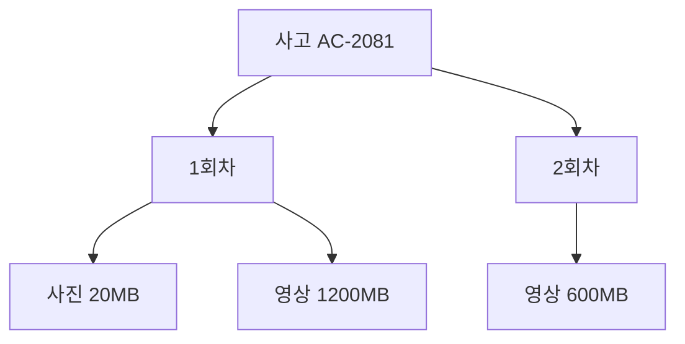

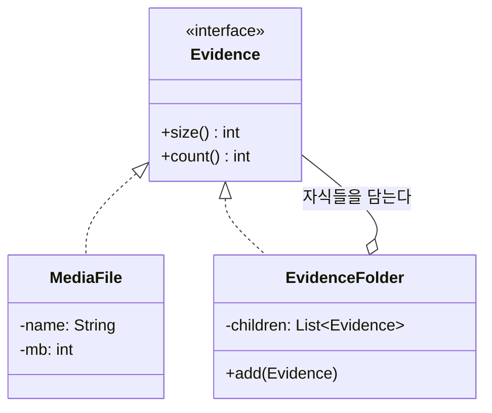

**시퀀스 다이어그램 (호출 흐름)**

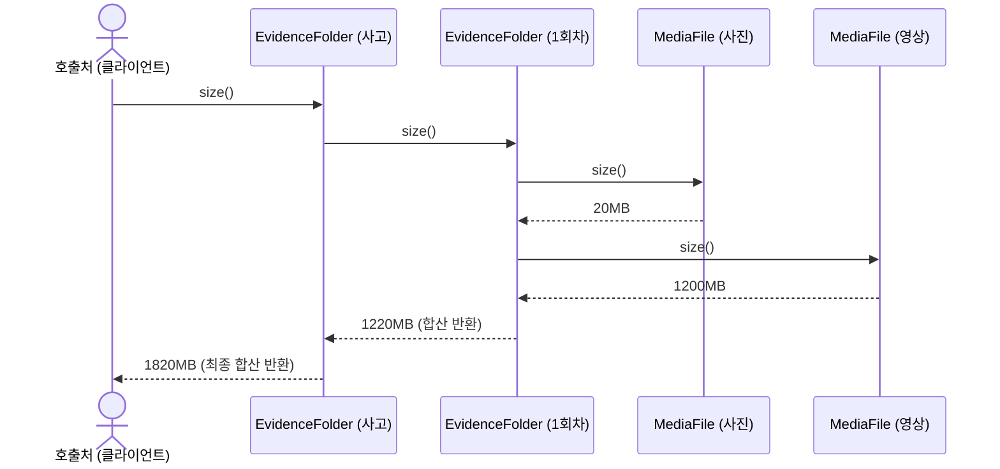

* **데모 확인**: `1회차: 2건, 1220MB` / `사고 전체: 3건, 1820MB` (동일한 `.size()` 호출)
* **관련 코드**: `composite/` 패키지

---

## 슬라이드 3. Decorator – 처리 단계 조립

| 구분 | 내용 |
| :--- | :--- |
| **1) 도메인 상황** | • 사진/영상이 들어오는 출처마다 거쳐야 하는 작업이 다릅니다.<br>• **고객이 앱으로 올릴 때**: 남의 차 번호판이나 행인 얼굴이 찍혔으니 `[압축]`하고 `[개인정보 마스킹]`을 해야 합니다.<br>• **현장 직원이 올릴 때**: 법적 증거 자료이므로 위조/변조를 막기 위해 `[압축]`하고 `[위변조 방지 해시코드]`를 생성해야 합니다.<br>• **나중에는?**: 일부 사진엔 `[AI 파손 부위 판독]`도 추가로 붙인다고 합니다. |
| **2) 개발자의 고민** | • `고객앱용_업로더`, `현장조사용_업로더`, `AI붙은_고객앱_업로더`...<br>• 필요한 조합마다 클래스를 만들다 보면 수십 개가 생겨서 감당이 안 됩니다 (**클래스 폭발 문제**). |
| **3) 패턴 해결책** | **"서브웨이 샌드위치나 커피 토핑처럼 감싸서 조립하자!"**<br>• 기본 빵(기본 수신: `BasicUploader`)이 있습니다.<br>• 그 위에 치즈를 얹듯 **압축(`Compress`)**으로 감싸고, 그 위에 베이컨을 얹듯 **마스킹(`Mask`)**으로 또 감쌉니다.<br>• 예시 코드: `new Mask(new Compress(new BasicUploader()))`<br>• **효과**: 나중에 `AI판독`이 추가되면? 새 클래스 하나 쓱 만들어서 `new AI(new Compress(...))` 형태로 끼워 넣기만 하면 끝납니다! 기존 코드는 손댈 필요가 없습니다. |

**비유**: 커피 토핑. 기본 커피에 샷, 시럽, 휘핑을 자유롭게 추가하는 구조입니다.

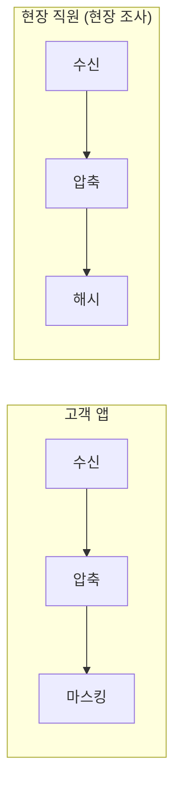

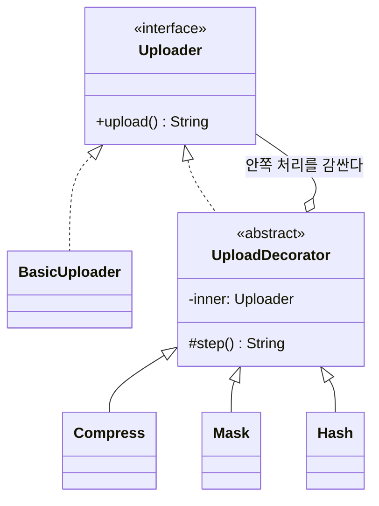

**시퀀스 다이어그램 (체인 호출 흐름)**

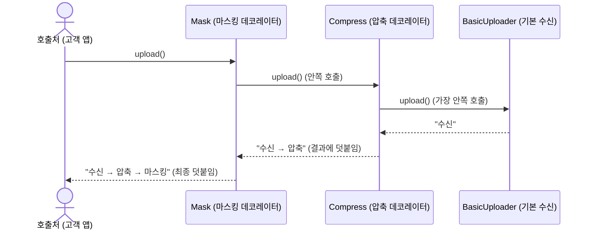

* **데모 확인**: `수신 → 압축 → 마스킹` / `수신 → 압축 → 해시`
* **관련 코드**: `decorator/` 패키지

---

## 슬라이드 4. Bridge – 미디어 종류와 저장소 분리

| 구분 | 내용 |
| :--- | :--- |
| **1) 도메인 상황** | • **올리는 미디어 종류**: 사진, 동영상 (나중엔 블랙박스 추가 예정)<br>• **저장할 저장소 위치**: 비싸지만 빠른 고속 스토리지, 싸지만 느린 장기 보관용 스토리지 (나중엔 외부 아카이브 추가 예정) |
| **2) 개발자의 고민** | • 상속으로 만들면 이렇게 됩니다:<br>  - `고속저장소_사진`, `보관저장소_사진`<br>  - `고속저장소_영상`, `보관저장소_영상`<br>• 만약 여기에 블랙박스(미디어)와 외부 아카이브(저장소)가 추가되면? 클래스 개수가 $3 \times 3 = 9$개로 곱하기로 불어납니다. |
| **3) 패턴 해결책** | **"무엇을(미디어)과 어디에(저장소)를 분리하고, 다리(Bridge)로 잇자!"**<br>• **왼쪽 축(미디어)**: `Media` 추상 클래스 밑에 `Photo`, `Video`만 만듭니다.<br>• **오른쪽 축(저장소)**: `Storage` 인터페이스 밑에 `HotStorage`, `ColdStorage`만 만듭니다.<br>• **다리 놓기**: `Media` 클래스 안에 `Storage storage;` 변수를 하나 넣어둡니다.<br>• **예시**: "동영상을 고속저장소에 넣어줘" ➔ `new Video("video-07", new HotStorage())`<br>• **효과**: 미디어 3종류, 저장소 3종류가 되어도 클래스는 딱 **6개(3+3)**만 있으면 됩니다. 곱하기($N \times M$)가 아니라 더하기($N + M$) 구조로 깔끔해집니다! |

**비유**: 전원 플러그와 콘센트. 어떤 기기든 규격에 맞는 콘센트에 자유롭게 꽂을 수 있습니다.

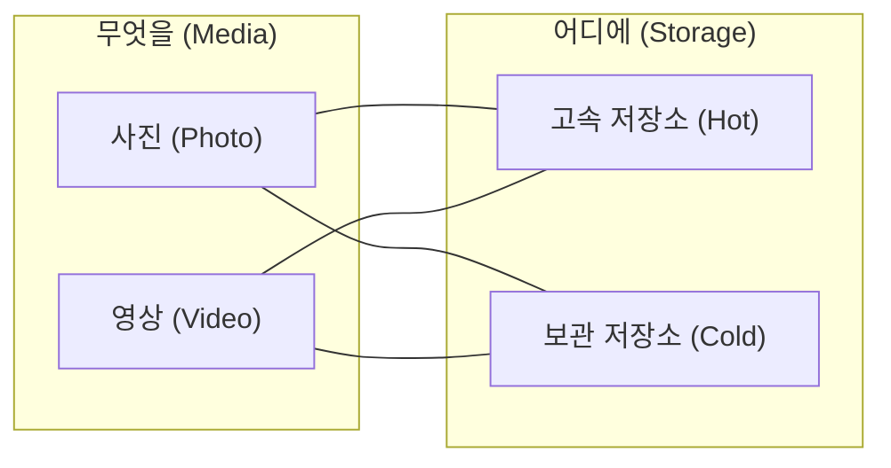

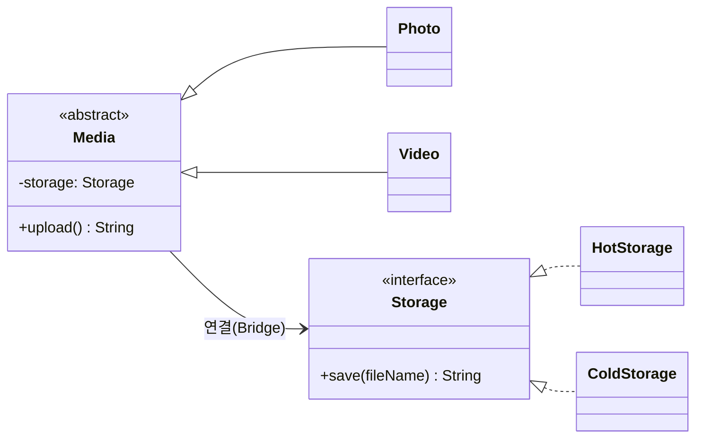

**시퀀스 다이어그램 (위임 호출 흐름)**

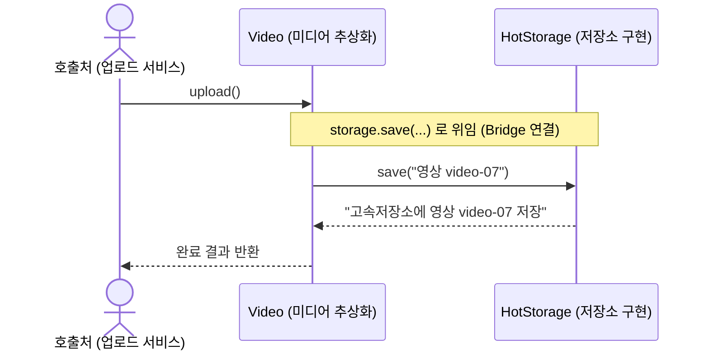

* **데모 확인**: `new Video("video-07", new HotStorage()).upload()`
* **관련 코드**: `bridge/` 패키지

---

## 슬라이드 5. Proxy – 지연 로딩 및 권한 통제

| 구분 | 내용 |
| :--- | :--- |
| **1) 도메인 상황** | • **문제 4-A (성능)**: 사고 건을 클릭해서 파일 목록(리스트)만 보려고 하는데, 뒤에 있는 1.2GB짜리 동영상 원본을 매번 디스크에서 읽어오면 서버 메모리가 터지고 속도가 엄청 느려집니다.<br>• **문제 4-B (보안)**: 다친 부위 사진이나 진단서 같은 **민감한 의료정보**는 콜센터 상담원이 함부로 열람하면 법적으로 큰일 납니다. 반드시 **손해사정사** 같은 권한 있는 사람만 봐야 합니다. |
| **2) 개발자의 고민** | • "목록 볼 때 무거운 동영상 원본을 매번 안 읽어오게 하려면 코드를 어떻게 짜야 하지?"<br>• "의료 정보 권한 체크 로직을 비즈니스 코드 곳곳에 if문으로 다 도배해야 하나?" |
| **3) 패턴 해결책** | **"진짜 영상 앞에 깐깐한 비서(`Proxy`)를 세우자!"**<br>• 비서(`VideoProxy`)와 진짜 영상(`RealVideo`)은 둘 다 똑같이 `open()`이라는 약속(`Viewable`)을 갖고 있습니다. 사용자는 비서와 대화하는지, 진짜 영상과 대화하는지 모릅니다.<br>• **비서의 행동 1 (보안 검사 - Protection Proxy)**: 콜센터 상담원이 열람을 요청하면? ➔ 비서가 **"권한 없음! 거절합니다"** 하고 진짜 영상은 보여주지도 않고 쫓아냅니다.<br>• **비서의 행동 2 (필요할 때만 로드 - Virtual Proxy)**: 목록만 볼 때는 무거운 영상을 절대 안 불러옵니다. 손해사정사가 진짜로 **"재생(Play)"** 버튼을 누르는 순간! 그때 비로소 진짜 영상을 메모리에 올려서 틀어줍니다.<br>• **효과**: 불필요한 서버 부하를 완전히 막고, 민감한 개인정보/의료정보를 완벽히 통제할 수 있습니다. |

**비유**: 비서. 방문자가 권한이 있는지 먼저 확인하고, 꼭 필요한 순간에만 대표를 연결합니다.

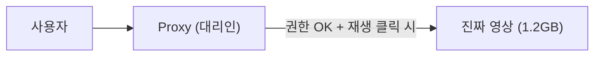

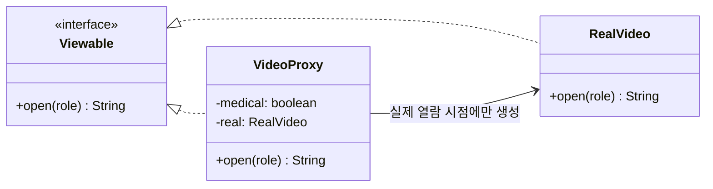

**시퀀스 다이어그램 (보안 거절 & 지연 로딩 흐름)**

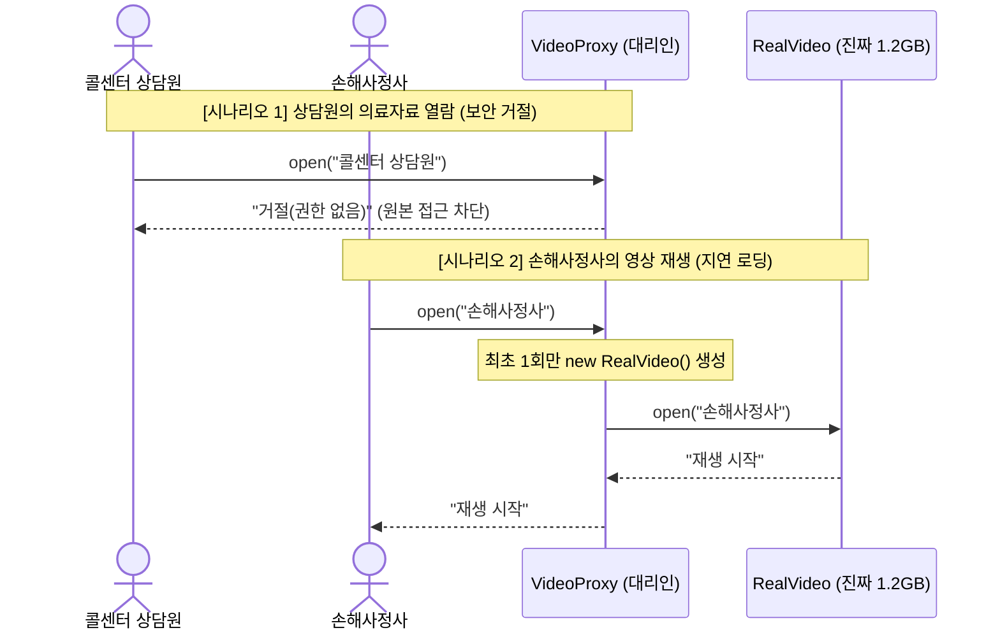

* **데모 확인**: 목록 조회 시 로드 0회 → 재생 시 원본 로드 / 상담원 접근 거절
* **관련 코드**: `proxy/` 패키지

---

## 슬라이드 6. 핵심 요약 (발표 마무리)

| 바뀌는 것 (요구사항 변화) | 보호하려는 것 (불변) | 적용 패턴 |
| :--- | :--- | :---: |
| 증빙 계층 구조의 변화 (사고군 추가) | 일관된 용량·건수 조회 인터페이스 | **Composite** |
| 출처별 가공 단계와 순서의 변화 | 기존 처리 파이프라인의 독립성 | **Decorator** |
| 미디어 종류와 저장소 인프라의 확장 | 미디어-스토리지 간의 결합도 최소화 | **Bridge** |
| 로딩 타이밍 최적화 및 접근 권한 통제 | 클라이언트 호출 코드의 단순성 | **Proxy** |

> **🎤 5줄 요약 마무리 멘트**
> 1. **계층적 증빙 폴더 구조**는 ➔ **Composite** 패턴으로 조회를 단일화했습니다.
> 2. **출처별 가공 파이프라인**은 ➔ **Decorator** 패턴으로 레고 블록처럼 유연하게 조립했습니다.
> 3. **미디어 종류와 저장소의 조합 문제**는 ➔ **Bridge** 패턴으로 두 축을 분리해 클래스 폭발을 막았습니다.
> 4. **대용량 부하와 의료정보 통제**는 ➔ **Proxy** 패턴을 대리인으로 세워 성능과 보안을 모두 확보했습니다.

---

## 부록. 라이브 데모 & 예상 질의응답

**데모 실행 명령**
```powershell
cd C:\Users\SDS\Desktop\usecase\team3-media
.\run.ps1
```

**예상 질문 & 답변**
* **Q. Decorator와 Strategy의 차이는 무엇인가요?**
  * Strategy는 여러 알고리즘 중 **'하나를 선택'**하는 목적이고, Decorator는 여러 부가 기능들을 **'순서대로 겹쳐서 확장'**하는 목적입니다. 본 시스템은 압축, 마스킹, 해시 등을 순서대로 함께 적용해야 하므로 Decorator가 적합합니다.
* **Q. Proxy 클래스가 지연 로딩과 권한 검사를 둘 다 하는 이유는 무엇인가요?**
  * 발표의 명확성을 위해 하나의 대리인 객체로 단순화했습니다. 실제 대규모 엔터프라이즈 설계에서는 `LazyLoadingProxy`와 `AccessControlProxy`로 책임을 분리하여 체이닝할 수 있습니다.
* **Q. State나 Adapter 패턴을 쓰지 않은 이유는 무엇인가요?**
  * 3조의 범위는 미디어의 '수집·가공·저장·열람'입니다. 상태 전이(State)는 현장 배정 워크플로우를 담당하는 5조의 문제이며, 대외 기관 전문 변환(Adapter)은 1조의 문제이므로 각 도메인 문제에 정확히 부합하는 패턴만 선별 적용했습니다.
